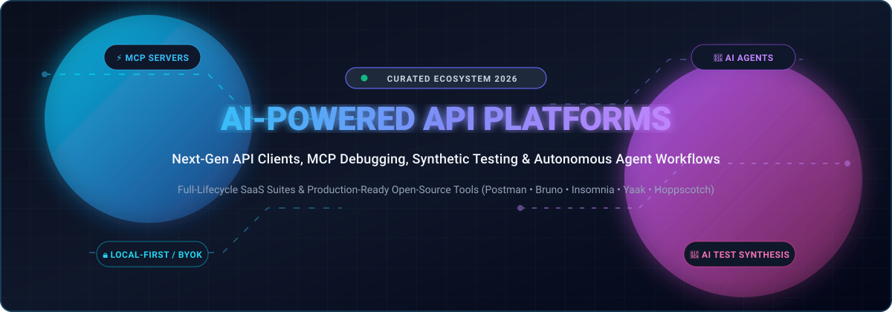

# 🚀 Awesome AI-Powered API Development Platform

**The Ultimate Curated Directory of Next-Generation API Development Platforms, MCP Debugging Suites, AI Test Generation Engines & Autonomous Agent Workflows**

  
  
  
  
  
  
  

**🌟 Star this repository if you find it valuable! Updated regularly for 2026. 🌟**

---

## 📖 Table of Contents

- [🌐 Overview](#-overview)
- [📊 Sector Overview & Market Dynamics](#-sector-overview--market-dynamics)
- [💼 SaaS & Commercial Platforms](#-saas--commercial-platforms)
- [🔓 Open-Source GitHub Projects](#-open-source-github-projects)
- [🧩 Composable AI API Engineering Stacks](#-composable-ai-api-engineering-stacks)
- [🤝 How to Contribute](#-how-to-contribute)
- [💖 Support](#-support)
- [📜 Disclaimer & Security Best Practices](#-disclaimer--security-best-practices)
- [⭐ Star History](#-star-history)

---

## 🌐 Overview

This curated list tracks the premier **SaaS platforms** and **open-source tools** powering **AI-assisted API development**. These modern platforms empower software engineers, QA specialists, and DevOps teams to design, simulate, debug, and document REST, GraphQL, gRPC, and WebSocket APIs with artificial intelligence assistance.

Modern platforms range from **agentic workspaces** with native **Model Context Protocol (MCP)** execution to **local-first, Git-native clients** offering bring-your-own-key (BYOK) privacy controls without vendor cloud lock-in.

---

## 📊 Sector Overview & Market Dynamics

The global API management and development software market is valued at approximately **$8.8 billion to $13.5 billion in 2026** and is projected to expand beyond **$35 billion by 2032** at an accelerating CAGR of **28%**, propelled by microservices expansion, cloud-native architectures, and generative AI tool integration.

The market remains **moderately to highly fragmented rather than a winner-take-all monopoly**. While established incumbents like Postman command large market share in cloud collaboration and enterprise API discovery, specialized niches—such as privacy-first Git-synced clients (Bruno), local mock servers (Mockoon), Kubernetes-native execution platforms (Testkube), and agentic headless workflows (Yaak)—prevent single-vendor lock-in and encourage a healthy, federated multi-tool ecosystem.

---

## 💼 SaaS & Commercial Platforms

The table below evaluates prominent commercial and hosted API development platforms, sorted in descending order of **company valuation / scale**.

| Platform | Company Valuation / Revenue Scale | Pricing (Starting Paid Tier) | Free Tier Limits | Key AI & Architectural Highlights |
| :--- | :--- | :--- | :--- | :--- |
| **[Postman](https://www.postman.com/)** | **$5.6B Valuation** (~$313M+ Revenue) | **$19/user/mo** (Team, billed annually; Solo $9/mo) | Strictly **1 user**; 1,000 cloud monitoring calls/mo; limited AI tokens/month | AI Agent Builder, first-class MCP server debugging, synthetic test creation, and Flows workflow automation. |
| **[Insomnia (Kong)](https://insomnia.rest/)** | **$2.0B Valuation** (~$100M+ ARR via Kong Inc.) | **$10/user/mo** (Pro, billed annually; $12 billed monthly) | Up to **3 users** on Git Sync projects; 1,000 mock server calls/mo; unlimited local/cloud projects | Native MCP client/server connectivity, AI-assisted mock endpoint generation, commit suggestions, and local LLM GGUF execution. |
| **[RapidAPI Studio](https://rapidapi.com/studio)** | **$1.0B Peak Valuation** (~$24M ARR; Acquired by Nokia) | **$10/mo** (Basic marketplace tiers start $10–$29/mo) | Provider plans capped at **1,000 req/hr** and **500,000 req/mo**; consumer limits set by individual APIs | Comprehensive API marketplace integration, automated spec testing, endpoint monitoring, and cloud workspace syncing. |
| **[Bruno](https://www.usebruno.com/)** | **$3M Venture Funded** (Silverton Partners; 4M+ devs) | **$6/user/mo** (Pro annual; Ultimate $11/user/mo) | **Forever free** for core app & offline collections; capped at **2 workspaces** on free tier | Local-first plain-text Bru/YAML files, Git-native version control, and BYOK AI assistant (OpenAI, Anthropic, local Ollama). |
| **[Hoppscotch](https://hoppscotch.io/)** | **$3M Seed Funded** (OSS Capital; 80k+ GitHub stars) | **$6/user/mo** (Business; Enterprise Cloud $11/user/mo) | **Forever free** with **unlimited** collections, requests, environments, and runs; AI Assistant requires Enterprise | Real-time multi-protocol support (REST, GraphQL, WebSockets, MQTT), self-hostable Docker edition, and BYOK Enterprise AI assistant. |
| **[Thunder Client](https://www.thunderclient.com/)** | **Bootstrapped** (7M+ downloads; Private revenue) | **$3/user/mo** (Starter; Business $7/user/mo) | Capped at **250 collection runs/user/month**; Git sync and CLI restricted to paid tiers | Ultra-lightweight VS Code GUI extension, local data storage, and low memory footprint for seamless IDE testing. |
| **[Firecamp](https://firecamp.io/)** | **Bootstrapped** (Pre-series/seed; Private revenue) | **$49/mo** (Team plan for up to 15 seats) | Up to **5 team members** free forever; unlimited workspaces and collections | Multi-protocol API testing across REST, GraphQL, and WebSockets with collaborative workspace synchronization. |
| **[Apidog](https://apidog.com/)** | **Privately Held** (Bootstrapped / Private revenue) | **$9/user/mo** (Basic; Professional $18/user/mo) | Up to **4 users** free forever with unlimited branches and unlimited API design specifications | Desktop-native visual MCP debugger (STDIO and HTTP transports), AI Test Engine, intelligent mock servers, and CLI test runners. |
| **[Paw (RapidAPI for Mac)](https://paw.cloud/)** | **Acquired Asset** (Acquired by RapidAPI / Nokia) | **$0/mo** (Core Mac client 100% free; Cloud sync requires RapidAPI team tier) | **Forever free** desktop macOS license; cloud collaboration follows RapidAPI account tiers | Native macOS Swift interface, dynamic environment values, visual request builder, and code generator for 30+ languages. |

---

## 🔓 Open-Source GitHub Projects

Below are top-tier open-source API clients, testing assistants, and MCP orchestration platforms, **ranked in descending order by GitHub Stars** 🌟:

- **[Hoppscotch](https://github.com/hoppscotch/hoppscotch)** 
  - 🛠️ **Tech Stack**: Vue.js, TypeScript • **License**: MIT
  - 💡 **Key Features**: The most popular open-source API client. Features REST, GraphQL, WebSocket, SSE, Socket.IO, and MQTT testing; agentic Enterprise AI assistant; BYOK integration (OpenAI, Anthropic, Bedrock, Ollama); self-hostable via Docker.
  - ⚖️ **Trade-Off**: Agentic AI assistant capabilities are gated to Enterprise tiers.

- **[Bruno](https://github.com/usebruno/bruno)** 
  - 🛠️ **Tech Stack**: JavaScript, Electron • **License**: MIT
  - 💡 **Key Features**: Git-native, privacy-first API client saving collections directly in plain text (Bru / YAML). Integrated AI assistant (Beta) with BYOK for test, script, and documentation generation with zero telemetry sent to vendor cloud.
  - ⚖️ **Trade-Off**: Lacks built-in visual MCP client transport debugging compared to Postman/Apidog.

- **[Insomnia](https://github.com/Kong/insomnia)** 
  - 🛠️ **Tech Stack**: Electron, React • **License**: Apache 2.0 Core
  - 💡 **Key Features**: Generous free AI tooling with native MCP Client and Server execution. AI-assisted mock server generation, commit suggestions, multi-protocol execution, and local LLM GGUF inference for data sovereignty.
  - ⚖️ **Trade-Off**: Local offline LLM execution requires adequate developer hardware; lacks autonomous chat workflows.

- **[Yaak](https://github.com/mountain-loop/yaak)** 
  - 🛠️ **Tech Stack**: Rust, Tauri • **License**: MIT / Commercial
  - 💡 **Key Features**: Ultra-fast, agent-first desktop client. Replaces in-app chat with an agent-friendly CLI (`@yaakapp/cli`) and MCP server plugin designed for Claude Code, Codex, and Cursor to orchestrate requests programmatically.
  - ⚖️ **Trade-Off**: No in-app conversational assistant; designed entirely for external AI agent drivers.

- **[Mockoon](https://github.com/mockoon/mockoon)** 
  - 🛠️ **Tech Stack**: TypeScript, Electron • **License**: MIT
  - 💡 **Key Features**: The fastest way to run realistic mock APIs locally. Features built-in AI endpoint generation, realistic JSON synthesis, route rules, proxy mode, CLI runner, and Docker containers for CI/CD.
  - ⚖️ **Trade-Off**: Cloud collaboration and specialized remote team sync are part of commercial cloud tiers.

- **[API Dash](https://github.com/foss42/apidash)** 
  - 🛠️ **Tech Stack**: Flutter, Dart • **License**: Apache 2.0
  - 💡 **Key Features**: Beautiful, lightweight, native cross-platform desktop and mobile client. Supports REST & GraphQL request creation, response inspection, and AI-assisted code generation across multiple languages.
  - ⚖️ **Trade-Off**: Younger ecosystem without complex enterprise governance or native MCP server protocols.

- **[Restfox](https://github.com/flawiddsouza/Restfox)** 
  - 🛠️ **Tech Stack**: Vue.js, Web Standards • **License**: MIT
  - 💡 **Key Features**: Completely offline-first, browser-based and desktop HTTP client. Minimalist UI, zero account registration, local IndexedDB persistence, and pluggable scripting.
  - ⚖️ **Trade-Off**: Pure testing client without built-in AI features; relies on external agent scripting.

- **[Firecamp](https://github.com/firecamp-dev/firecamp)** 
  - 🛠️ **Tech Stack**: TypeScript, Electron • **License**: GPL-3.0
  - 💡 **Key Features**: Multi-protocol developer platform for WebSocket, Socket.IO, GraphQL, and REST. Team workspaces, environment configuration, and planned AI test generation integrations.
  - ⚖️ **Trade-Off**: Full generative AI features are still rolling out across the desktop client.

- **[Yaade](https://github.com/EsperoTech/yaade)** 
  - 🛠️ **Tech Stack**: Kotlin, React • **License**: MIT
  - 💡 **Key Features**: Fully self-hosted, multi-user collaborative API platform with end-to-end encryption for security-sensitive organizations. Easily scriptable REST API for automated testing.
  - ⚖️ **Trade-Off**: Does not include embedded LLM assistants; focuses on secure data hosting.

- **[Step CI](https://github.com/stepci/stepci)** 
  - 🛠️ **Tech Stack**: Node.js, TypeScript • **License**: Apache 2.0
  - 💡 **Key Features**: Declarative, code-first framework for API testing and QA automation. Uses simple YAML/JSON definitions across REST, GraphQL, gRPC, and WebSockets. Perfect target for coding agents generating regression test suites.
  - ⚖️ **Trade-Off**: Code-first and CLI-centric; lacks an interactive GUI workbench.

- **[Testkube](https://github.com/kubeshop/testkube)** 
  - 🛠️ **Tech Stack**: Go, Kubernetes • **License**: MIT
  - 💡 **Key Features**: Kubernetes-native testing engine featuring a native Model Context Protocol (MCP) server. Enables AI assistants (Claude, Cursor) to execute and debug Postman, k6, and Cypress suites directly within Kubernetes clusters.
  - ⚖️ **Trade-Off**: Enterprise Kubernetes infrastructure required; not intended for simple local endpoint ad-hoc testing.

- **[Sentinel API Testing](https://github.com/proffesor-for-testing/sentinel-api-testing)** 
  - 🛠️ **Tech Stack**: Python, Rust, React • **License**: MIT
  - 💡 **Key Features**: Autonomous API testing platform utilizing ephemeral agents. Generates and runs functional, security (BOLA, injection), and stress tests from OpenAPI specifications with BYOK multi-model support.
  - ⚖️ **Trade-Off**: Autonomous testing platform rather than an interactive daily exploratory client.

- **[JARVIS](https://github.com/dipjyotimetia/JARVIS)** 
  - 🛠️ **Tech Stack**: Go, CLI • **License**: MIT
  - 💡 **Key Features**: Terminal-native testing assistant powered by Generative AI. Analyzes OpenAPI/Protobuf specifications, generates test suites and edge cases, performs automated root-cause analysis, and features a traffic inspector proxy.
  - ⚖️ **Trade-Off**: CLI-only without desktop GUI; early-stage open-source community.

---

## 🧩 Composable AI API Engineering Stacks

Modern software engineering teams are combining these open-source tools into custom, vendor-agnostic development environments:

1. **The Git-Native Developer Stack**: Combine **Bruno** (for Git-tracked collections and local offline editing) with **Mockoon** (for AI-generated local endpoints).
2. **The Agentic Autonomous Stack**: Combine **Yaak** (via its headless CLI and MCP plugin) with **Claude Code** or **Cursor** for automated request dispatching and test validation.
3. **The Cloud-Native CI/CD Stack**: Pair **Step CI** or **Testkube MCP** with local **Ollama** models for automated regression testing and intelligent failure diagnosis in Kubernetes.

---

## 🤝 How to Contribute

Contributions are welcome from the developer community! To add or update an entry:

1. 🍴 Fork the repository.
2. 📝 Add or refine entries in `README.md` following the established formatting guidelines.
3. 🔍 Ensure all tool URLs, pricing tiers, and open-source licenses are accurate and verifiable.
4. 🚀 Submit a Pull Request with a descriptive summary of your changes.

---

## 💖 Support

If this repository helps you navigate the AI-powered API landscape, please consider supporting the project:

- ⭐ **Star** this repository on GitHub!
- 🍴 **Fork** and contribute new tools or updates.
- 📢 **Share** this list with fellow platform engineers, backend developers, and QA leads!
- ☕ **Sponsor & Buy a Coffee**: Support ongoing maintenance through the [GitHub Sponsor Dashboard](https://github.com/sponsors/ishandutta2007).

---

## 📜 Disclaimer & Security Best Practices

- This repository is a community-curated directory intended for research and educational purposes.
- **Data Protection & Credentials**: AI-powered API tooling frequently processes proprietary OpenAPI contracts, environment tokens, and authentication headers. Ensure that your organization's data governance standards (GDPR, CCPA, SOC2) and BYOK policies are maintained before sending API payloads to external cloud LLMs.
- Self-hosted solutions (such as **Bruno**, **Hoppscotch Docker**, or **Mockoon**) are strongly recommended when strict data sovereignty or air-gapped environments are mandatory.

---

## ⭐ Star History

---

  <b>Built with ❤️ for API Developers, Platform Engineers, and QA Teams worldwide.</b>

